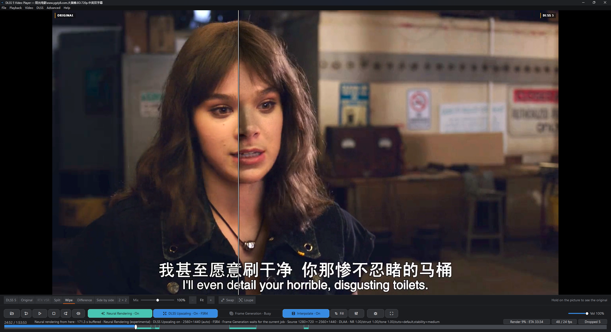
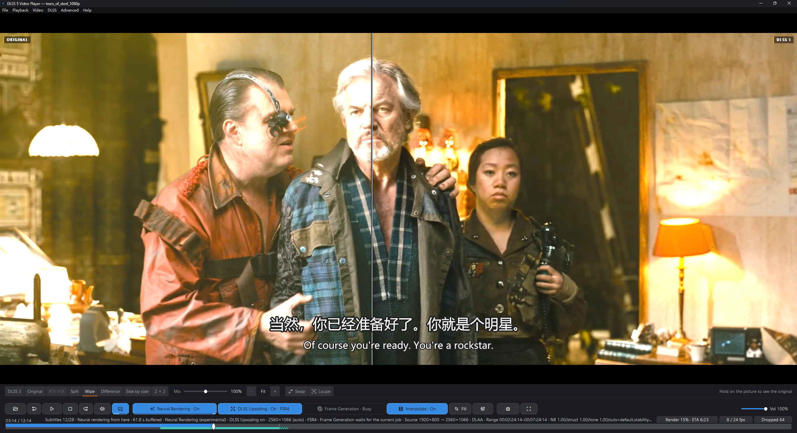

# DLSS 5 Video Player — AMD

**Put any video through DLSS 5's neural renderer on an AMD Radeon, and check
every frame against the original.**

A free, open-source player for Windows. Open a video, a photo or a GIF and press
`D`: within seconds the render plays while the rest of the video renders behind
you, and the original is one key away on the same frame. Other DLSS 5 tools
convert files or filter the desktop live; this one renders the whole video
progressively, keeps every frame, and shows you what the model changed, and where
it didn't help. [How it compares](docs/RELATED_PROJECTS.md).

Special thanks to **lmxxf** for porting DLSS 5 to AMD Radeon (9070 XT) — this AMD
backend would not exist without their work. See the porting project at
[github.com/lmxxf/dlss5-on-amd-9070xt-porting](https://github.com/lmxxf/dlss5-on-amd-9070xt-porting).

The AMD backend's neural runtime payload currently ships **`OptiScaler-DLSS5-AMD-0.44`**
(host DLL `OptScaler-NR-1.13.0-alpha8`, ABI `(6, 176)`). Its neural pass is
bit-exact against 0.43's — ffmpeg reads `psnr = inf` — as long as the custom
config keeps `DLSS5_MULTI_PASS=2`, because the package's own default is now the
31-block **Small** model at 0.5x. The two things 0.44 adds to the weights
(`small/` and `post70-history-head.f16`) are what this build's Small rung and the
fast-history mode read. See
[the runtime package](third_party/lmxxf/README.md).

Subtitles are this fork's other addition. A film that carries no subtitle track
is transcribed from its own audio by whisper.cpp, translated locally by
llama.cpp, and both lines are drawn over the render — the model never touches
the text. The recogniser runs on the graphics card when its second build is
installed: 60 s of audio costs 298 s of CPU time on 12 cores against 2.63 s on
an RX 9070 XT, for the same transcript.
[How the chain works](#subtitles-listen-to-the-film-then-translate-it).



The whole window, on an AMD card: *Bumblebee* at 1280x720 in **Split**, source
left of the divider and render right. The toolbar reads **Neural Rendering · On**,
**DLSS Upscaling · On · FSR4** and **Interpolate · On**, and the status line says
what each is doing — `DLSS Upscaling on: 2560x1440 (auto) · FSR4`, `Source
1280x720 -> 2560x1440`, `48 / 24 fps`

> [!NOTE]
> **A fork of [DLSS 5 Video Player](https://github.com/2600th/dlss5-video-player)
> with an AMD backend.** The player, the compare views, the render cache, the
> export pipeline and the documentation are upstream's work. What this fork adds
> is a backend for all three stages: the neural pass runs on an RDNA 4 Radeon
> through `LmxxfNrRuntime`, and upscaling and frame generation on FidelityFX's
> engines, with no NVIDIA add-on, no NGX and no ReShade. **The NVIDIA backend is
> upstream's and is not supported here** — see the note further down.
> [What the AMD backend does, and does not do](#on-an-amd-card) ·
> [AMD captures](#what-it-looks-like) ·
> [integration plan and status, in Chinese](docs/AMD-LMXXF-INTEGRATION-PLAN-REV2-zh.md) ·
> [the runtime package](third_party/lmxxf/README.md)

[Upstream project](https://github.com/2600th/dlss5-video-player) · [On an AMD card](#on-an-amd-card) · [Subtitles](#subtitles-listen-to-the-film-then-translate-it) · [Build it](#building-and-contributing) · [First run](#first-run) · [Usage guide](docs/USAGE.md) · [Troubleshooting](docs/TROUBLESHOOTING.md)

> [!IMPORTANT]
> Community project, not an NVIDIA or an AMD product. The neural runtime on
> either backend is a modified, unsigned community build. ~~On the NVIDIA backend
> neural rendering needs an RTX card and driver 610.47 or newer;~~ on the AMD
> backend it needs an RDNA 4 Radeon and the runtime package, which this
> repository does not ship — see [On an AMD card](#on-an-amd-card). Notices:
> [THIRD_PARTY.md](THIRD_PARTY.md).

## On an AMD card

This fork's addition. Neural rendering runs through `LmxxfNrRuntime.dll` — the
AMD runtime — instead of the NVIDIA add-on, and upscaling and frame generation
have engines of their own behind the same menu items. The player picks the
backend itself at startup: if the NVIDIA layout is absent and the AMD runtime
package is present and matches the manifests it ships, neural rendering is
offered on it. It is not a menu choice, because a machine has one of the two.
`--neural-backend amd` does the same from the command line.

| | AMD backend |
| --- | --- |
| GPUs | RDNA 4 (`gfx1200`, `gfx1201`); measured on an RX 9070 XT |
| Stages it can run | All three: neural rendering (`nr`), upscaling (`sr`) and frame generation (`fg`). Not NVIDIA's engines: no RTX VSR, no DLSS Super Resolution, no DLSS-G — this backend brings its own |
| Upscaler | FSR 4 (FidelityFX upscaler 4.1.1), else FSR 1's EASU, else Catmull-Rom, the last two sharpened with CAS. One setting, **DLSS > Upscaled by**, serves the source frames and the interpolated ones alike |
| Frame generation | FidelityFX frame generation: live at 2x during playback (**Frame Generation during playback**, `Ctrl+Alt+G`, off by default), or a 2x–5x offline conversion (**DLSS > Generate frames**) that writes a new file |
| Encoder | AMD's `hevc_amf` on the GPU for the two lossy rungs — HEVC 8-bit at QP 18 for Standard, Main10 at QP 16 off the 10-bit capture for High — with libx264 kept as the fallback for an odd frame size or a machine without the encoder. Lossless is FFV1 10-bit on the CPU. `-rc qvbr` refuses to initialise on this driver, so the rungs use constant QP |
| Input size | The runtime admits up to 1920×1080 by pixel budget. A 1440p or 4K source has to be scaled down before it reaches the runtime |
| Processing scale | Must be 100%. The runtime returns the frame at the size it was given, so a reduction would be silently ignored; this player refuses instead. The upscaler runs after the model, on the frame it returned |
| Passes | The ladder's first rung is the 0.44 **Small** model at 0.5x — 31 blocks, a differently trained network, single-pass by construction — and 1, 2 and 3 stack the Original 71-block one (the runtime's own F9 ladder), with switches for the later passes only: keep skin tones, predict the third pass instead of running the network, and skip the later passes' block group. Every extra pass is another full network run. 4 is NVIDIA's ladder; this runtime reads a count it does not know as Small, so the player clamps it |
| Temporal model | Three layers, and the panel owns all three. **The runtime's own temporal mode** (**Neural settings > Temporal mode**: off, fast history, low-frequency EMA, low-frequency + detail) makes the network fuse history. It is off unless the runtime's own config file already set it — the panel migrates that value on first read rather than overwriting a hand edit — and it runs only beside the Original model at one pass: beside Small the runtime renders the Original instead, and above one pass it runs no mode at all and says so in a status line. The panel greys the control out at both of those rungs rather than handing over a pair the runtime would resolve by itself, and the key is read once when the network is built, so a change reaches the next render and a running session keeps the mode it started with. **The guides are no longer constants**: the player runs its own estimator (CPU block matching on a 128x72 grid at 720p, 160x90 at 1080p, 0.8–1.4 ms a frame, no optical flow on an AMD card) and hands the field to the runtime, which is what gives it anything to fuse. **The player's own accumulation** (**Temporal stability**, AMD default Low) then blends the previous output through that same field, so it reprojects instead of smearing. FSR 4 reads the field too: see [Upscaling](#upscaling-and-frame-generation) |
| Colour | SDR. The cache capture is 8-bit with ordered dither at Standard, and 10-bit at High and Lossless — P010 out of the FP16 history slot, written as HEVC Main10 at High and FFV1 at Lossless — which needs a Temporal stability rung on, because that is where the FP16 slot comes from. HDR is not wired on this path |
| Speed | **≈10 ms a frame at 720p and ≈21 ms at 1080p** for the neural pass alone — one pass of the Original model with the guide pair on, submit p50 on an RX 9070 XT, of which the network itself is 4.6 and 8.5 ms. That is 4.0x and 1.9x a 24 fps frame's budget before a live session's own decode, present and encode. Every job pays a cold start of **6.9–10.0 s**. [Measured speeds](#render-speed-and-the-render-ahead-window) has the numbers, what they cost, and which of them are measured rather than derived. The upscale's and the interpolation's own cost is unmeasured, and so are 900 and 4K |
| What it needs | The `amd-neural-runtime/` package — 325 MiB as a download, 844 MiB unpacked, from this fork's [`lmxxf-<line>` release](https://github.com/myth2loki/dlss5-video-player-on-amd/releases) — beside the module directory or at the root of the checkout, or named by `DLSS5_AMD_RUNTIME_DIR`. For the two newer stages, FidelityFX's `amd_fidelityfx_loader_dx12.dll` beside the exe, with `amd_fidelityfx_upscaler_dx12.dll` and `amd_fidelityfx_framegeneration_dx12.dll` — three files, in the packaged build, that [the notices](docs/THIRD-PARTY-NOTICES.md) list |
| Add-on, ReShade, `dxgi.dll` | None. This backend loads no proxy and registers no add-on |

Measured on an RX 9070 XT: the player resolves and logs the pack at startup, the
offline export writes a file, a range render with preroll — the shape a live
session uses — passes, a 744-frame clip converts to 1,488 frames (30 → 60 fps)
with its audio and its duration, and the upscaler takes a 1280x720 source to
2560x1440 through the tier it starts on. Generated frames were also measured
frame by frame against the two frames they sit between, which is how the
brightness strobe in the interpolated cadence was found and then fixed. The
capture has been measured at both of its bit depths — P010 at High and Lossless,
8-bit with the cache's own dither at Standard, 10-bit differing from 8-bit by
58.37 dB, which is that rounding and nothing else — and the two lossy rungs are
written on the GPU by `hevc_amf` now (Lossless is still FFV1 on the CPU): 1146
KiB at 52.07 dB in 775 ms against libx264's 1232 KiB at 51.94 dB in 1430 ms on
the same 48 frames. The captures below are a
live session's compare views, so `D` has since been driven end to end on the same
card. Half an hour of continuous playback has now been walked through as well —
33 minutes of a 1280x720 film in chunks (120 s each then, five minutes now),
six published cache entries; each of its three session starts waited 6–7 s for
its first chunk and then never waited again — and **a cache hit after a session
is verified**: a reopened source asked for its whole-video entry, the entry
answered from the record its promotion had written — the payload's size, times
and file id — rather than reading the payload again (3 ms), and playback opened
it without rendering a frame.

Opening a source no longer waits for that identity either. The original is opened
and drawn first, and the identify runs behind it: 72 ms to `Opening local file`
and 3.8 s to the picture on an 80 MB clip, where the same open used to spend
15.4 s hashing a 5,004 s film and 707 runtime files before the first frame —
for an answer that was "nothing in the cache" anyway. What the identify finds is
a report, not a takeover: a hit stays in hand for the neural switch, and the
original keeps playing either way, because opening a cached playback starts at
its own range and would restart the film.

That hit used to be impossible, and the reason was not the one it looked like.
The runtime's identity digest covered every file in the runtime tree, including
`lmxxf_runtime.log`, which the runtime appends to on every job — so every
finished chunk changed the key the next one looked under, and no session could
find the entry the one before it had published. The digest is taken over the
modules and weights now (the log and the shader cache are skipped), and two
independent sessions on one source record the same identity. The
[integration plan](docs/AMD-LMXXF-INTEGRATION-PLAN-REV2-zh.md) (Chinese) records
what was measured, on what, and what was not.

### Render speed and the render-ahead window

The neural pass is the whole cost, and it is linear in pixels. Measured on an RX
9070 XT, one pass of the Original model with the guide pair on — the shipped
default — submit p50 is the frame's guide upload, network evaluate and gate end
to end:

| | 1280×720 | 1920×1080 |
| --- | --- | --- |
| Pixels | 921,600 | 2,073,600 |
| Guide estimator, CPU | 0.8 ms | 1.4 ms |
| Submit p50 | **10.3 ms** | **21.4 ms** |
| — of which the network | 4.6 ms | 8.5 ms |
| A 24 fps frame's budget | 41.7 ms | 41.7 ms |
| The render alone | **4.0× real time** | **1.9× real time** |

2.25× the pixels costs 2.08× the frame, and the envelope around the network
grows with it as well: it is 5.7 ms of 10.3 at 720p and 12.9 of 21.4 at 1080p.
At 30 fps the same 1080p frame is 1.6× the budget, not 1.9× — 64% of it spent
converting, before the player decodes, upscales and presents anything.

**That envelope used to be four times its size.** The guide field is computed as
a block-matching grid and was resampled onto the frame before every upload:
12.6 MB of area averages a frame for motion and 6.3 MB more for depth at
1920×822. The runtime reads motion at the extent the field declares
(`motionWidth`/`motionHeight`, and clamps to it), so the grid can travel as
itself — 57 KB — and the depth expansion, which cannot shrink because the
kernel indexes the whole texture by the render size, moved from a CPU resample
to a draw over a 43 KB upload. 1920×822, 96 frames, submit p50:

| Guide arm | Submit p50 | Real time at 23.976 fps |
| --- | --- | --- |
| constant guides (the floor) | 14.78 ms | 2.82× |
| full-frame motion, CPU depth | 39.06 ms | 1.07× |
| full-frame motion, GPU depth | 28.78 ms | 1.45× |
| **grid motion, GPU depth** | **15.08 ms** | **2.77×** |

A live session on the last arm read 16.57 ms p50, rendered its whole 53 s tail
28 s in, and dropped nothing. The grid field and the frame-extent field it
replaced agree at 54.50 dB, so the bytes were the only thing lost:
`DLSS5_AMD_GRID_GUIDES=0` and `DLSS5_AMD_DEPTH_EXPAND=0` restore either
baseline for an A/B.

**What a chunk adds.** A chunk also pays its cold start and the
join-and-validate step that turns its segments into a cache entry, neither of
which is render time. On a 49–73 MB block that step took 996–1653 ms: about
460 ms joining 61 segments and 432–459 ms probing the joined file. Segments are
3 s now, so a 120 s block holds 41 and joins in 289–397 ms, and the join reports
the frame count it muxed through FFmpeg's progress stream, so the probe reads a
header instead of demuxing and decoding the whole file — 124–128 ms on real
publishes. A block publishes in ≈590–780 ms, on the critical path between two
chunks; a five-minute block holds 100 segments and scales with them. None of it
changes what playback shows.

**Two paces, and they are not the same number.** One is how fast the render
itself goes: the submit p50 above. The other is the session's average, which
also counts the time the window spends deliberately idle between chunks. At
720p those read ≈4× and about **1.2×** on a half-hour film — that second number
is arithmetic, not a stopwatch: 33 minutes watched plus the five-minute window
it keeps ahead, over the 33 minutes, is 1.15×, and it is the fall a viewer
notices as the chip idling on purpose. The status line's ETA uses the session
average, since a viewer waiting on the film does experience the idle; the
scheduler that decides when to start the next chunk uses the render's own pace.
Pricing the schedule on the average would put the drain point at ~260 s of a
300 s window instead of 180 s, which leaves a chunk no room to overrun.

Every job also pays a **cold start** — helper launch, runtime bring-up, the
first output — measured at **6.9–10.0 s** end to end on this card, of which
4.2 s is before the first frame comes back, at 720p and at 1080p alike. A window
pays that once per chunk, which is the whole reason for the next table.

**Why the window is five minutes.** A chunk costs one cold start plus its own
render, so the overhead as a share of a chunk is `S/(S + N/ratio)`, and on this
card `S × ratio` is about 14 seconds of video at 720p and at 1080p alike — the
startup slows down in the same proportion the render does:

| Window | Cold start's share of a chunk |
| --- | --- |
| 1:00 | 19% |
| 1:30 | 13% |
| 2:00 | 10% |
| 3:00 | 7% |
| **5:00** | **4%** |

Past two minutes the curve is flat, and the window moved to five for the other
end of the trade: what a viewer pays for video rendered past a pause is bounded
by the drain point below, not by the window. At 4× a 300 s chunk lands in about
75 s of wall clock, 7–10 s of it cold start; at 1.9×, 160 s. **DLSS > Render
ahead** carries the same five rungs and Off; the drain point is settings-file
only.

**When the next chunk starts.** The trigger is the buffer, not the playhead:
the next chunk starts once the lookahead has drained to
`[Playback] NeuralWindowLowWaterSeconds` — **three minutes by default**, clamped
to the window whatever it says. That mark is stated rather than derived, and
deliberately: the formula it replaced priced a chunk's own wall clock
(`coldStart + window/ratio + 5`), which is right about not starting a refill
that stalls immediately and wrong about a card that cannot keep up — there it
pinned the mark at the window itself, the session rendered its window, and the
render went quiet with a full buffer while the viewer kept watching. Set the
key to 0 to get the formula back; a window smaller than the mark simply drains
fully before the next chunk starts.

Two cases still bend it, and both are handled rather than hidden. If a chunk
overruns — one measured here finished with 31 s of buffer left where its mark
expected 67 — the next one simply starts later, and coverage keeps landing every
second or two while it runs, so the buffer grows through a chunk rather than
draining. And a GPU slower than the video (this card is not, at any resolution
the runtime admits) renders as soon as the buffer is below the mark, because
converting past a pause is better than a session that freezes.

**What that costs over a film.** Rendering all of a two-hour film costs about 30
minutes of GPU at 720p and an hour at 1080p-class, and a session that renders
ahead of the playhead never spends that. With a five-minute window the
render follows the viewer: ten minutes watched is ten minutes of video
converted — about two and a half minutes of GPU at 720p, five at 1080p-class,
plus two cold starts — and nothing beyond the last five minutes is touched.

### Upscaling and frame generation

The two stages that used to be NVIDIA's alone run here too, on AMD's FidelityFX
engines and the player's own shaders rather than on NVIDIA's.

**Upscaling.** The toolbar's DLSS Upscaling switch is answered by this backend,
not by NGX: the pill names the tier serving the frame — `DLSS Upscaling · On ·
FSR1` — and **DLSS > Upscaled by** picks it: Auto, FSR 4, FSR1 or CAS. Auto is
the cascade FSR 4, then FSR 1's EASU, then Catmull-Rom, with CAS sharpening on
the last two. A chosen tier is the cascade's entry point, not a dead end: one
that fails hands the frame to the next tier down and says so in the log, so the
two halves of a cadence can never end up on different engines. FSR 4 is AMD's
learned, temporal upscaler and needs the FidelityFX upscaler DLL; without it
EASU serves every frame, and without that, Catmull-Rom. The output height is
**Upscaling output** — 1080p, 1440p, 2160p, or Auto for the largest your monitor
shows — and the upscale happens after the model, on the frame it returned: a
1280x720 source still renders at 1280x720 and is then presented at 2560x1440. In
an export, the Super Resolution stage writes with the same stretch-and-sharpen
that is the playback chain's last resort, Catmull-Rom then CAS; FSR 4 is the
playback present, not the export's writer.

**What FSR 4 is fed.** A decoded frame has no camera, so two of the four inputs
a game supplies are honestly absent: jitter stays zero and exposure stays
constant at 1.0, because a per-frame jitter with nothing to compensate it is a
visible wobble and a metered luminance is not the auto-exposure FSR means. The
other two are measured now. The same estimator that feeds the neural chain hands
FSR 4 backward motion vectors in output pixels and a [0,1] depth proxy (0 near,
1 far), so its history reprojects against real motion instead of the identity;
on a frame the guide pass did not run for — Super Resolution off, or the cascade
stepped below FSR 4 — the constants come back, and `DLSS5_FSR4_GUIDES=0` puts
the identity reprojection back for an A/B.

**Frame generation.** Two different things, both FidelityFX's frame generation.
**Frame Generation during playback** (`Ctrl+Alt+G`, the **Interpolate** pill)
interpolates on screen as the video plays, at 2x the source rate: off by
default, remembered, and the frame-rate chip shows the higher rate only while
interpolated frames are actually being presented. **DLSS > Generate frames** is
the offline conversion — a new file at 2x to 5x, 2x by default. Three rules hold
either way. An interpolated frame takes the same upscaler tier as the real
frames around it, so a doubled cadence does not alternate in sharpness. It is
clamped into the brightness envelope of its two neighbours, so a hard edge
cannot overshoot. And its colour is decoded once, by the sampler — the doubled
sRGB decode that used to make generated frames come out bright is gone.

### What it looks like


Cropped to the picture, the same view: source left of the divider, render right.
It is film footage rather than a game trailer — grain, a shallow depth of field
and faces lit for a camera rather than for a renderer — and every capture in this
section is from that film.

[](docs/media/amd/amd-live-wipe.mp4)

Six seconds of the film in **Wipe**, while it plays: the divider sweeps across
the face, so both halves are the same frame at every moment. The animation above
is the clip, scaled and silent — [the MP4 keeps its sound](docs/media/amd/amd-live-wipe.mp4).


**2 × 2**: original, DLSS 5, **Difference** (4x, luma) and DLSS 5 at
**Mix 50%**. The fourth pane is the second Mix on this backend, not RTX VSR:
that pane is NVIDIA's upscaler, and this machine has none to put beside the
render.

| Source | Render |
| --- | --- |
|  |  |

A face, source left and render right, cropped from the film: pores, lashes and
the catchlight in the iris come back on the right.

### Subtitles: listen to the film, then translate it



The player can hear the film, write down what it says, and put the translation
on screen. Press the button next to the speaker in the toolbar and the whole
chain runs:

1. **Listen.** A film with no subtitle track of its own is transcribed from
   its own audio by [whisper.cpp](https://github.com/ggml-org/whisper.cpp),
   window by window, starting at the playhead rather than at the beginning:
   nobody wants the first twelve minutes of a film written down before they
   get there.
2. **Translate.** The transcript goes to a local
   [llama.cpp](https://github.com/ggml-org/llama.cpp) server running a Gemma
   model, which returns the translation in the language you picked.
3. **Draw.** The result is one ASS file with both lines in it — the
   translation above, the original below — and the overlay draws it over the
   render, so the model never warps the text.

Above: *Tears of Steel* in **Split**, neural rendering and FSR 4 on, the
film's English speech transcribed and translated into Chinese, and both lines
drawn under the picture. The status line says how far the transcript has got
(`Subtitles 12/35`).

**Which hardware does the transcribing** is in the **Subtitles** menu, under
*Transcribe on the graphics card* or *on the processor*, ticked to show which is
in force; *Subtitles from speech* there starts the transcription on its own,
without the toolbar button. It is worth the switch: on the same film and the
same model, 60 s of audio burns 298 s of CPU time on 12 cores against 2.63 s
on a 9070 XT — RTF 0.521 against 0.034 — and the transcript comes out word for
word identical either way.

**The engines are not in the package.** whisper and llama.cpp are MIT and may
travel with it, but the models are not redistributable, so both are opt-in at
packaging time (`-IncludeSpeechEngine`, `-IncludeSubtitleEngine`) and the
model files are yours to place:

| | engine | model | where |
| --- | --- | --- | --- |
| transcription | `asr\runtime\whisper-server.exe` (or `asr\runtime-gpu`) | `ggml-*.bin` | `asr\models\` |
| translation | `translation\runtime\llama-server.exe` | `*.gguf` | `translation\models\` |

With no engine installed the switch is grey and nothing is started: the button
is in the player, the engine is not. The [usage guide](docs/USAGE.md) has the
ini keys.

The NVIDIA path is untouched by any of this, and upstream still develops it. It
is **not** supported in this fork: it needs an RTX card with driver 610.47 or
newer, which this fork neither ships nor verifies, and the 10-bit ladder, HDR and
NVIDIA's own engines — RTX VSR, DLSS Super Resolution, DLSS-G — come with it. On
the AMD backend the picture is SDR and 8-bit, and the upscaler and frame
generation are the ones [above](#upscaling-and-frame-generation). Everything
downstream that needs NVIDIA's engines is struck through and marked unsupported.

> [!WARNING]
> **NVIDIA-only features are not supported in this fork.** RTX VSR, DLSS Super
> Resolution and DLSS-G are NVIDIA engines and need an RTX card with driver
> 610.47 or newer; this fork ships no NVIDIA build and cannot verify one.
> Everything that claims or shows them below is struck through or labelled as
> unsupported — the demo, the screenshots, the RTX GPU table, the `R` and
> `Shift+R` views — but the material is kept, because it is upstream's and
> describes the same player. Where they used to be, this build has its own: FSR
> 4, FSR 1 or CAS for the upscale, FidelityFX frame generation for the frames
> between. [On an AMD card](#on-an-amd-card) is the place to start.

## Upstream demo and stills

*NVIDIA backend — not supported in this fork. Kept because the player and its
compare views are the same on either backend; what each backend can run is the
part that differs.*

[](docs/media/neural-comparison-demo.mp4)

**[Watch the 25-second video](docs/media/neural-comparison-demo.mp4)** (1080p, no
sound), captured on the NVIDIA backend: *007 First Light* and *GTA VI* Trailer 2
rendered at default settings on an RTX 4080 SUPER, then the Difference, Side by
side and loupe views — the same compare views this build shows, on a backend this
build does not support.


One source frame (left) and the same frame of the player's render (right),
unscaled, on the NVIDIA backend. [Four more, including one where the model makes
the picture worse](docs/media/README.md#comparison-stills).

## Download

**A source zip of this fork would not run on its own, and there is no player
build to download yet.** The AMD runtime package is 325 MiB as a download and
844 MiB unpacked, and it is not in this repository, so a checkout carries no
backend until the pack is fetched — the same reason upstream's "Source code" zip
won't run. This fork publishes the pack as
[`lmxxf-0.44`](https://github.com/myth2loki/dlss5-video-player-on-amd/releases/tag/lmxxf-0.44);
the player still has to be built: [Build and test](docs/BUILDING.md), or one
command that builds and packages it (`build_and_package_amd.bat`). Put the
unpacked `amd-neural-runtime/` beside the module directory or at the root of the
checkout ([what is in it](third_party/lmxxf/README.md),
[how to integrate it](#integrating-the-backend-binaries-without-a-build)).

Upstream publishes signed builds of the NVIDIA version on
[its releases page](https://github.com/2600th/dlss5-video-player/releases), with
a `.sha256` beside each zip, GitHub attestations of what that repository built,
and a `verify_package.ps1` that checks the unpacked files against the package
manifest. Those are the upstream project's, not this fork's, none of them has an
AMD backend, and this fork does not support that backend — they are listed so a
reader knows where the other one lives.

## First run

1. Keep `neural-runtime/` next to the exe. (Upstream's zips say to unpack into a
   new, empty folder first.) On the AMD backend the `amd-neural-runtime/`
   package has to be reachable as well, and the three FidelityFX DLLs — loader,
   upscaler, frame generation — beside the exe for the upscale and the
   interpolation: see [On an AMD card](#on-an-amd-card) and [integrating the
   backend binaries](#integrating-the-backend-binaries-without-a-build).
2. Run `DLSSVideoPlayer.exe`. The player is not code-signed, so Windows may
   say "Windows protected your PC": choose **More info > Run anyway**. This fork
   has no signed builds to check against, so if you did not build it yourself,
   know where the binary came from.
3. Open a file (`Ctrl+O`), paste a public YouTube link (`Ctrl+L`), or pick
   something from **File > Game trailers**. The picture comes up first, and the
   player works out what the file is — source digest, runtime identity, whether
   a render of it is already cached — behind the playback rather than in front
   of it.
4. Press `D`. It buffers for a few seconds, then plays the render.
5. The compare bar under the picture switches between DLSS 5, Original, Split,
   Wipe, Difference, Side by side and 2 × 2.
6. **DLSS > Convert & export** saves the rendered video to a file.

**File > Recent videos** reopens a video with its render, if the render covers
the whole video. A live session publishes entries for the chunks it rendered —
five minutes of video each by default, `[Playback] NeuralWindowSeconds` — even
one that runs to the end leaves a set of them, and none of those answers a plain
open:
**DLSS > Convert & export > Convert whole video to neural video** writes the one
that does.

## What it does

- **Renders while you watch.** Playback moves onto rendered frames a few
  seconds after you press `D`, while the rest of the video fills in behind you,
  nearest first.
- **Seeks anywhere.** Rendered frames play wherever they are; elsewhere the
  original plays while the render catches up.
- **Shows you what the model did.** Split, Wipe, **Difference** (the change,
  amplified), **Side by side** and **2 × 2** views, a Mix slider, zoom to 8x, a
  4x **loupe**, a mask that limits DLSS 5 to part of the frame, and
  press-and-hold for the original. Switching views never moves the playhead.
- ~~**Compares against NVIDIA's own upscaler.** `R` shows RTX Video Super
  Resolution of the original as a view of its own and in the 2 × 2; `Shift+R`
  compares the other views against it. In the complete download, or a build
  made with the RTX Video SDK.~~ **Not supported in this fork** — that view
  needs an NVIDIA card. The AMD backend's own upscaler is under [On an AMD
  card](#upscaling-and-frame-generation).
- **Saves the evidence.** **File > Save comparison image** writes exactly what
  the picture shows, with a footer recording the video, frame, view, neural
  settings and runtime.
- **Subtitles and HDR.** SRT, ASS, WebVTT, PGS and VobSub are drawn over the
  render, so the model never warps the text. HDR10 and HLG are tone mapped to
  SDR for the model; ~~on an HDR display the original still shows in HDR.~~ On
  the AMD backend the output stays SDR, so the HDR display path is not available
  there.
- **Keeps your renders.** A whole-video render is reused while the source,
  runtime and settings still match, at Standard, High (10-bit) or Lossless
  quality. Each entry records the identity of the payload it published, so
  reopening it authenticates the file instead of hashing 50–70 MB again: 6.5–13
  ms against 32–74 ms, measured on live-session entries.
  `DLSSVideoPlayer.exe --cache-status <video>` says what a source has cached
  and what each entry would cost to open. **Advanced > Render report** shows the
  flicker, grain and colour shift a render added.
- **Works on screenshots and GIFs.** A photo renders once and stays on its
  frame; an animated GIF renders frame by frame, keeping its timing. See
  [Screenshots and GIFs too](#screenshots-and-gifs-too).
- **Saves the result as a file.** MP4 or MKV for a video, GIF for an
  animation, PNG or JPEG for a photo, from the player or the command line. See
  [Save the result](#save-the-result).
- **Tunes the model.** Change a neural setting (`Ctrl+N`) while paused and that
  frame re-renders. On the AMD backend that dialog also carries the three
  questions this backend adds: which model and how many passes (**Neural
  passes** — Small at 0.5x, or one to three Original passes), whether the
  network fuses history at all (**Temporal mode**, the runtime's own key, at the
  one rung where it can run), and how much of its own output the player's
  accumulation holds on to (**Temporal stability**). ~~**DLSS > Processing
  scale** runs the model at 75% or 50%
  of the source, for speed. Where the window shows a video larger than it is,
  NVIDIA's RTX Video Super Resolution upscales it, on by default: it measured
  well above a plain scaler and DLSS Super Resolution on video
  ([measurement](docs/measurements/vsr-quality-20261002/REPORT.md)). DLSS Super
  Resolution can still upscale playback to 1080p, 1440p or 2160p; it is off by
  default (see [Limits](#limits)).~~ **Not supported in this fork.** The AMD
  backend runs the model at the source size, so its processing scale has to stay
  at 100%, and it upscales with FSR instead — one switch and one menu in the same
  places ([details](#upscaling-and-frame-generation)).
- **Plays like a player.** AC-3, E-AC-3 and DTS passthrough to a receiver, and
  Windows media controls with taskbar thumbnail buttons.
- **Speaks the film's language.** A film that carries no subtitle track is
  transcribed from its own audio and translated, and both lines are drawn over
  the render. See [Subtitles](#subtitles-listen-to-the-film-then-translate-it).
- **Comes with test material.** Seven official game trailers, chosen for faces,
  skin and light, under **File > Game trailers** and on the start screen.

## Screenshots and GIFs too


Open a PNG, JPEG, BMP, TIFF or static WebP and press `D`. It renders once, the
compare views work as they do on a video, and it saves back as a PNG or JPEG
at full size. Above, a *Mafia: The Old Country* trailer frame saved as a
2560x1440 PNG, at default settings: the game's smooth orange skin comes back
with texture, a truer tone and light that falls across the face. ~~From the
command line it took 8 seconds on an RTX 4080 SUPER.~~ Animated GIFs render
frame by frame and keep their timing.

## Save the result

Everything you can watch rendered, you can keep as a file.

| Source | Saved as |
| --- | --- |
| Video, local or YouTube | MKV (default) or MP4. MKV keeps the source audio, subtitles and chapters without re-encoding them. |
| Animated GIF | GIF (default), MP4 or MKV |
| Photo: PNG, JPEG, BMP, TIFF or static WebP | PNG (default) or JPEG, at the source size |

Two ways under **DLSS > Convert & export**, and one from the command line:

- **Save converted video** writes the render you already have, without
  rendering again. It needs a render of the whole video, or of the clip you
  marked and converted with `Ctrl+R`.
- **Export with DLSS stages** (`Ctrl+S`) renders a new file with any of Super
  Resolution, neural rendering and frame generation (2x to 5x the frame rate),
  in NVIDIA's order. ~~Super Resolution on its own runs on RTX VSR by default -
  the upscaler that measured best - or on DLSS Super Resolution if you choose
  it under **Upscaler**.~~ On the AMD backend all three stages run too; there the
  Super Resolution stage writes with the player's own stretch-and-sharpen,
  Catmull-Rom then CAS, frame generation at 2x to 5x runs on FidelityFX's
  runtime, and the lossy rungs are written on the GPU by AMD's `hevc_amf` —
  HEVC 8-bit at QP 18 for Standard, Main10 at QP 16 off the 10-bit capture for
  High — falling back to libx264 only for an odd frame size or a machine
  without the encoder. At 3840x2160 the encode alone went 6045 ms → 1569 ms.
- **From the command line**, `dlss5-convert` runs the same export without
  opening the player, waits for it and shows its progress. Give it files,
  folders or wildcards; this writes `clip-dlss.mkv` beside the input:

  ```bat
  dlss5-convert clip.mp4
  ```

  Every stage and Neural setting is an option. Three stacked neural passes of
  the strong look, frame generation at 3x, a folder upscaled to 4K
  ~~with RTX VSR (the default upscaler; `--sr-engine dlss` picks DLSS)~~ with
  whatever upscaler the machine has — on AMD, FSR 4, FSR 1 or CAS — and a folder
  rendered and upscaled together:

  ```bat
  dlss5-convert clip.mp4 --preset strong --passes 3
  dlss5-convert clip.mp4 --stages fg --multiplier 3
  dlss5-convert clips -r --stages sr --height 2160 --out-dir clips-4k
  dlss5-convert clips -r --stages sr,nr --height 2160 --out-dir clips-nr-4k
  ```

  `dlss5-convert probe clip.mp4` says what a file is and which stages this
  machine can run on it. `--range`, `--encode`, `--report` and the rest are in
  the [usage guide](docs/USAGE.md#from-the-command-line).

  On the AMD backend all three stages are the same switches; `--neural-backend
  amd` names that backend, and its Super Resolution and frame generation run on
  FidelityFX's engines under the same flags:

  ```bat
  dlss5-convert clips -r --stages sr,nr,fg --neural-backend amd
  ```

  The AMD runtime also has a second, smaller network: `--small-model` runs its
  0.44 Small model (31 blocks at 0.5x, single-pass by construction, so it forces
  `--passes` to 1) instead of the Original 71-block one — a faster pass whose
  output differs. It also suspends the runtime's temporal mode, which only runs
  beside the Original model at one pass; the panel greys that control out under
  the same rule:

  ```bat
  dlss5-convert clip.mp4 --neural-backend amd --preset strong --small-model
  ```


The dialog is the same on either backend; the **Upscaler** row in this capture is
NVIDIA's, and that choice is not supported here — on AMD the Super Resolution
stage writes with this build's own FSR upscaler.

## How it compares

Several open-source projects put DLSS 5's neural pass on video. This one is
built to watch the result and check it: it renders the whole video while you
watch, keeps the render, and shows the original beside it on the same frame.
As of 2026-10-02, from each project's README, releases and issues (details in
[RELATED_PROJECTS.md](docs/RELATED_PROJECTS.md); corrections welcome):

| | **DLSS 5 Video Player** (this) | [Visual Enhancer](https://github.com/Merserk/dlss5-visual-enhancer) v14.0 | [NeuralScreen](https://github.com/perseval-BLR/NeuralScreen) v2.1.9 | [Veyra](https://github.com/Likely7/Veyra-NRVideo) 2.0.0 | [DLSS5Tool](https://github.com/banbanzhige/DLSS5Tool) v2.3.3 |
| --- | --- | --- | --- | --- | --- |
| What it is | A player that renders the whole video in the background, plus export | A converter with a stage pipeline, plus a Live mode | An overlay on the whole desktop, plus file conversion | A real-time player for files, capture cards and game streams | A converter with a preview |
| Neural render you can keep, seek and re-watch | Yes: rendered frames are cached and reused | No: Live keeps a 2–30 s buffer | No: real time | No: real time | Export only |
| Compare tools | Split, Wipe, Difference, Side by side, 2×2, loupe, hold for original, against RTX VSR | Split, 2-Up | Before/after wipe | Original/enhanced toggle | Wipe, side by side |
| Upscaling | ~~RTX VSR by default in playback and export, DLSS SR on request; [measured](docs/measurements/vsr-quality-20261002/REPORT.md)~~ NVIDIA only, not supported in this fork. On AMD: FSR 4, FSR 1 or CAS | RTX VSR and DLSS SR stages, off by default | None (by design) | DLSS SR, RTX VSR or FSR | RTX VSR 2× or 4× |
| Frame generation | ~~DLSS-G 2–5× as a conversion; RTX 20/30 through an offered, hash-checked add-on~~ NVIDIA only, not supported in this fork. On AMD: FidelityFX 2–5× as a conversion, 2× live | DLSS-G as a conversion | DLSS-G 2–4×, live | DLSS-G, XeSS or FSR up to 6×, live | DLSS-G 2×, export |
| Inputs | Local video, public YouTube, photos, GIFs | Images, video, URLs, YouTube, Twitch | Anything on screen, files | Files, images, capture cards, PS5, PC and Xbox streams | Images, video, image sequences |
| Keeps audio / subtitles / chapters on export | Yes / yes / yes | Yes / no / yes | Audio yes | Audio and subtitles yes | Audio yes |
| HDR | HDR shown on HDR displays; exports are SDR | 10-bit HDR export, SDR→HDR | HDR10 recording (experimental capture) | HDR kept, HEVC Main10 export | HDR10/HLG export |
| Command line | `dlss5-convert`: files, folders, JSON report | `VE_CLI.exe` | No; a GUI queue | Not documented | Not documented |
| Download | None in this fork; upstream's is 377 MB (36 MB without the neural runtime) | 726 MB | 230 MB | 409 MB | 580 MB lite |
| Verifying the download | Upstream's: SHA-256, GitHub attestations, a file manifest and a verifier script | GitHub's per-file digest | SHA256SUMS and a runtime manifest | SHA-256 files | Runtime hashes |
| Licence | MIT | Source-available, its own terms | PolyForm Strict (non-commercial) | GPL-3.0 (AGPL for its streaming part) | MIT |

> Every row above describes the player on the **NVIDIA backend**, which is what
> upstream built and what this comparison was written against. The AMD backend
> runs the same three stages on different engines: FSR 4, FSR 1 or CAS for
> upscaling, FidelityFX frame generation at 2x live and 2x to 5x in a
> conversion, and the neural pass through `LmxxfNrRuntime` — see
> [On an AMD card](#on-an-amd-card).

Of the five, only this player keeps the render, so a seek lands on rendered
frames and a video you come back to is already done. It compares the render
with the original on the same frame in more ways than any of the others
~~, RTX VSR included~~; only its export keeps subtitles and chapters as well as
audio; and only its downloads carry GitHub attestations of what this repository
built. On the AMD backend the upscaler is this build's own; the measurement
linked above is upstream's, of NVIDIA's engine, and does not apply here.

None of these projects is an NVIDIA product, and each runs the neural pass on a
runtime build NVIDIA has not published for this use, this one included. Upstream
publishes its own builds only on
[its releases page](https://github.com/2600th/dlss5-video-player/releases);
re-uploads of DLSS 5 tools under other accounts have been reported carrying
malware. This fork publishes nothing — see [Download](#download).

## What's new in 0.28.2

Upstream's release notes for the player this fork is built on. They are about
the NVIDIA backend, which this fork does not support. This fork still publishes
no release, but its tree carries a version: `VERSION` reads **0.29.2**, moved
there by the AMD backend — 0.28.3 for the guide field, 0.29.0 for the ten-bit
capture, 0.29.1 for the AMF encoder, 0.29.2 for a receipt wait this backend
never writes — and its changes are the ones described above, in no numbered
release.

**0.28.2** (2026-10-04). Neural settings now do what they say, and say what they
do. Renders made with the default settings are reused.

- **Apply changes the picture during neural playback** ([#15](https://github.com/2600th/dlss5-video-player/issues/15)).
  It used to restart the render and put the previous one straight back on
  screen. It now renders from the playhead with the new settings.
- **Intensity and Color strength reach every neural pass.** With two or more
  passes they changed only the first.
- **Every control says what it was measured to do**
  ([report](https://github.com/2600th/dlss5-video-player/blob/main/docs/measurements/knobs-upper-20261003/REPORT.md)).
  Intensity runs 0-1, because the runtime renders anything higher exactly as
  1.00; Style is the strongest control and costs no render time; Skin
  structure's "Off" was "As structure".
- **Neural settings opens with the Look preset** and a line that says what
  Apply will do to the picture on screen. The default preset is now
  **Standard**, and **Strong** really is stronger: 22 % further from the source
  than Standard, against 6 % before.
- **`dlss5-convert --style`**, so a script can render with one style and render
  the result again with another.
- Smaller fixes: a dead menu path in the frame generation prompt, measured
  ranges listed as keys on the shortcuts sheet, and a shorter status line.

Earlier releases are in [CHANGELOG.md](CHANGELOG.md); 0.28.1 made RTX VSR the
upscaler in playback and exports, 0.27.2 offered the
dlssg_sm86 add-on for Frame Generation on RTX 20 and 30, 0.27.0 added
`dlss5-convert`, the command-line converter, 0.26.2 fixed GPU decoding of
untagged HD video, and 0.26.0 added the compare views, RTX VSR beside DLSS 5,
subtitles, HDR, the render quality ladder and `--render`.

## Controls

| What | Key |
| --- | --- |
| Open a file / a YouTube URL | `Ctrl+O` / `Ctrl+L` |
| Play or pause | `Space` |
| Neural rendering on or off | `D` |
| Compare views | `C` / `Shift+C` step the mode; `X` swaps sides; `[` and `]` change the Mix |
| RTX VSR view; compare against it | ~~`R`; `Shift+R` (NVIDIA backend)~~ — not supported |
| Zoom, loupe | `Z` / `Shift+Z` zoom in and out at the pointer; `L` loupe |
| Save the view as a PNG | `Ctrl+Shift+S` |
| Subtitles; earlier, later | `V`; `H`, `J` |
| Every shortcut | `?` or `F1` |
| Seek ten seconds / step one frame | `Left` / `Right`; `.` |
| Mark In / Out; clear; go to time | `I` / `O`; `Shift+I`; `Ctrl+G` |
| Render one frame / four seconds / the marked clip | `F` / `Shift+F` / `Ctrl+R` |
| Generate frames; cancel a conversion | **DLSS > Generate frames**; `Esc` |
| Frame generation during playback | `Ctrl+Alt+G` (the **Interpolate** pill) |
| Neural settings | `Ctrl+N` |
| Export with DLSS stages | `Ctrl+S` |
| Image adjustments | `Ctrl+E` |
| Volume, mute | Mouse wheel; `M` |
| Fit or fill; fullscreen | `A`; `F11` |
| Stop | `S` |

Settings persist between launches. A fresh install starts with neural rendering
on, ~~RTX VSR Upscaling on,~~ DLSS Upscaling off, frame generation during
playback off, and DLSS's output and YouTube quality on **Auto**: the
largest resolution your monitor can show, and the best YouTube stream up to
1440p. RTX VSR is NVIDIA's and does nothing here; on the AMD backend the DLSS
Upscaling switch is answered by this player's own FSR upscale instead. Both are
covered under [On an AMD card](#on-an-amd-card).

The [usage guide](docs/USAGE.md) covers the rest, including frame generation
and the cache. The trailer list is in [EXAMPLE_VIDEOS.md](docs/EXAMPLE_VIDEOS.md).

## Screenshots (NVIDIA backend — not supported)

~~The player paused on one frame of *007 First Light* rendered at default
settings: the first four on an RTX 5090 at 100% display scaling, the next three
on an RTX 4080 SUPER at 150%.~~ **Not supported in this fork.** These are
upstream's captures, kept because the player and its compare views are the same
on either backend; this build's own captures are in [On an AMD
card](#what-it-looks-like). Click any image for full size.


One 540p frame shown at 1.51x: the player's plain scaling left of the divider,
RTX VSR right, unscaled crop ([whole window](docs/screenshots/current/vsr-wipe.jpg)).
The measured comparison is the
[RTX VSR quality report](docs/measurements/vsr-quality-20261002/REPORT.md), not
this frame.


The file that save wrote, footer and all:
[`saved-comparison-2x2.png`](docs/screenshots/current/saved-comparison-2x2.png).


### Start screen


### Neural view on and off


One paused frame with only the view switched, at default settings. It shows
how the toggle works, not what every source will gain.

[Capture details and footage attribution](docs/screenshots/README.md).

## Limits

- **Speed.** ~~On an RTX 5090 a live session costs about 6.8 ms a frame at
  1080p30, 9.9 ms at 1440p30 and 23 ms at 4K30, all faster than the video plays.
  An RTX 4080 SUPER measured 15.3 ms at 1080p30 on 0.16.0 and has not been
  re-measured since. 4K depends on the file.~~ Those are NVIDIA numbers, and this
  fork does not support that backend. The AMD figures are in [On an AMD
  card](#on-an-amd-card). After your first session the player knows your GPU and
  warns you before a video it expects to fall behind on.
- ~~**Driver 610.47 or newer (NVIDIA backend).** Older drivers refuse neural
  rendering on any card, and the player tells you up front. See
  [troubleshooting](docs/TROUBLESHOOTING.md#neural-rendering-is-refused-because-the-driver-is-too-old).~~
  **Not supported in this fork.** The AMD backend does not go through the NVIDIA
  driver's neural stack at all.
- ~~**Which RTX GPU does what (NVIDIA backend):**~~ **Not supported in this
  fork.**

  | ~~GPU~~ | ~~Neural rendering~~ | ~~RTX VSR upscaling~~ | ~~DLSS Super Resolution~~ | ~~Frame generation~~ |
  | --- | --- | --- | --- | --- |
  | ~~RTX 50~~ | ~~Yes; tested on an RTX 5090~~ | ~~Yes; measured on an RTX 5090~~ | ~~Yes~~ | ~~Yes, up to 5x here~~ |
  | ~~RTX 40~~ | ~~Yes; tested on an RTX 4080 SUPER~~ | ~~Yes~~ | ~~Yes~~ | ~~Yes, 2x~~ |
  | ~~RTX 30~~ | ~~Untested, and expected several times slower without native FP8~~ | ~~Yes~~ | ~~Yes~~ | ~~Only with the community dlssg_sm86 add-on; a user ran 4x on an RTX 3060~~ |
  | ~~RTX 20~~ | ~~As RTX 30, untested~~ | ~~Yes~~ | ~~Yes~~ | ~~Only with the add-on; untested~~ |

  ~~NVIDIA's own DLSS 5 support is RTX 50 only, and this player runs neural
  rendering on a modified community runtime on every generation, RTX 50
  included. RTX VSR costs about 1.5 ms for a 1080p frame
  and 2.7 ms for a 1440p one at High on an RTX 5090; slower cards pay more, and
  the player lowers its quality for a video it cannot keep up with.~~ **None of
  that applies to this fork.** For the AMD backend, [On an AMD
  card](#on-an-amd-card) has its own table, and the rest of this list holds for
  it unless it says otherwise.
- **Depth is estimated from the picture**, and so is motion on cards without
  the optical flow engine — on an AMD card there is no optical flow, so both come
  from the player's CPU block matcher, at about 10–12 source pixels a cell.
  Expect some artifacts at occlusions, on small objects and past either end of
  its search range.
- **Ghosting has three sources on this backend, and they are separable.** The
  player's own accumulation (now reprojected through the guide field; it is Low
  by default for exactly this reason), frame generation's interpolated
  midpoints, and FSR 4's history. [Troubleshooting](docs/TROUBLESHOOTING.md#the-amd-render-looks-smeared-or-doubled-ghosting)
  has the order to switch them off in, one at a time. A guide field that is
  *wrong* is not a fourth one on the accumulation rung: its trust test compares
  the source at the reprojected position, so a mis-measured vector closes the
  gate and loses stability there rather than smearing. FSR 4 has no such test —
  a bad vector puts its history in the wrong place, which is what
  `DLSS5_FSR4_GUIDES=0` is for.
- ~~**DLSS Super Resolution doesn't beat a plain scaler on video.** Against
  bicubic on six clips, it scored lower on all of them. It is built for games;
  use it for its look, not for detail. RTX VSR, the default upscaler, is the
  one that adds detail: 87.5 VMAF against bicubic's 80.5 and DLSS's 74.9 over
  the same kind of test.~~ **Both engines are NVIDIA's; not supported here.**
- **Frame generation writes a new file.** It takes time and disk space, and a
  stream has to be copied locally first. ~~On the NVIDIA backend RTX 40 and 50
  cards support it; on RTX 20 and 30 the player offers to download the
  community [dlssg_sm86 add-on](docs/TROUBLESHOOTING.md#rtx-20-and-30-the-dlssg_sm86-add-on),
  which is unofficial and not bundled.~~ On the AMD backend it runs on FidelityFX's
  frame generation at 2x to 5x; an export without that DLL falls back to the
  player's own block matcher, whose motion search is single-scale, so fast motion
  ghosts. Interpolating during playback needs the runtime, and is the cheap way
  to see the effect: nothing is written, and it is the same engine.
- **An upscale is an upscale, whichever engine writes it.** On the AMD backend
  FSR 4 has no jitter to work with and a constant exposure — a decoded frame is
  one fixed sample grid and has no camera — and while it does now reproject
  against the guide estimator's motion and depth, that field is a block matcher's,
  not a renderer's: its history can only be as good as a decoded frame and a
  ten-pixel cell allow. FSR 1 and CAS are pure spatial filters. None of the three
  invents detail the neural pass did not produce — they present that frame
  larger, with CAS adding edge acutance on the way.
- **The two new stages cost time the neural pass did not.** On this backend both
  are extra passes over the same frame, so a machine already near its frame
  budget at 1080p will feel them; the figures in [On an AMD
  card](#on-an-amd-card) measure the neural pass alone.
- **Save converted video copies the cached render as it is**: 8-bit at the
  default Standard quality, 10-bit at High or Lossless once a Temporal stability
  rung is on, without adjustments, upscaling or HDR. Use **Export with DLSS
  stages** to bake in a larger size.
- **Not supported:** burning subtitles into an export, a render queue in the
  player (`dlss5-convert` converts a list or a folder in turn), or resuming an
  interrupted render after a restart.
- **YouTube:** public, non-DRM videos only, no login. Age-restricted videos can
  arrive as a 640x360 stream, and the status line tells you when that happens.
- **Disk space.** The cache keeps renders until the drive falls below 20 GB
  free, then deletes the least recently used first. **Advanced > Clear Neural
  Cache** shows how much it will free before it does.
- **Partial renders aren't joined.** A session started partway into a video
  leaves separate renders of the parts it covered, so reopening that video
  renders it again. A plain open asks only for the whole-video entry; **DLSS >
  Convert & export > Convert whole video to neural video** writes that entry
  once, and every open after it is a cache hit.
- **Network use.** Besides YouTube links, the player checks GitHub once a day
  for a new release (the menu bar then shows `↑ Update <version>`), and the
  start screen fetches the trailers' thumbnails from `i.ytimg.com`, again only
  when a cached one is a month old. `[Updates] Enabled=0` and
  `[Start] ThumbnailFetch=0` in `DLSSVideoPlayer.ini` turn these off.
  ~~On an RTX 20 or 30 card, the dlssg_sm86 add-on is downloaded only if you
  accept the offer.~~ That add-on is NVIDIA's and is not supported here.

## Building and contributing

C++20, Win32, Direct3D 12, FFmpeg, and on top of that one of two neural
runtimes: NVIDIA NGX on the NVIDIA backend, or `LmxxfNrRuntime` on the AMD one —
where FidelityFX's loader, upscaler and frame generation DLLs carry the other two
stages.

- [Build and test](docs/BUILDING.md), [runtime setup](docs/DLSS5_SETUP.md)
- [Architecture](docs/ARCHITECTURE.md), [technical overview](TECHNICAL_OVERVIEW.md)
- The AMD backend: [integration plan and status](docs/AMD-LMXXF-INTEGRATION-PLAN-REV2-zh.md) (Chinese), [what the temporal accumulation costs and how it is measured](docs/AMD-TEMPORAL-ACCUMULATION-zh.md), and [the runtime package](third_party/lmxxf/README.md)
- **Before changing the AMD backend**, read [the pitfalls list](docs/AMD-BACKEND-PITFALLS-zh.md) (Chinese): the shared files that may not be touched, the guide field's units and extents, the runtime config's write order, and the traps that have already cost an afternoon each
- Hardware test records: the `VERIFICATION-*.md` files in [docs](docs/) — upstream's, on the NVIDIA backend
- [Contributing](CONTRIBUTING.md): the checks a pull request must pass

### Integrating the backend binaries without a build

The AMD backend is two things that have to match. A **runtime pack** —
`amd-neural-runtime/`: `LmxxfNrRuntime.dll`, 80 HSACO modules for
`gfx1200`/`gfx1201`, the tiled network weights, the runtime's own shaders and
`DLSS5-AMD/custom-config.txt` — which is data and never needs compiling. And the
**code** that drives it: `DLSSVideoPlayer.exe`, `neural-runtime/NeuralWorker.exe`
and the three FidelityFX DLLs beside it, which is what CMake builds. Both can come
from outside this repository.

**The pack alone, into a source checkout.** This fork's releases carry the pack
and nothing else, so a checkout plus this zip is a runnable backend as soon as
the player is built (`build_and_package_amd.bat`, see
[Build and test](docs/BUILDING.md)):

```powershell
$tag    = 'lmxxf-0.44'
$sha256 = '8965AC8919106EC59E24B21F44F31E534AC026C0895FE7FF4E51AADAC9131C8F'
Invoke-WebRequest "https://github.com/myth2loki/dlss5-video-player-on-amd/releases/download/$tag/amd-neural-runtime.zip" -OutFile amd-neural-runtime.zip
if ((Get-FileHash amd-neural-runtime.zip -Algorithm SHA256).Hash -ne $sha256) { throw 'amd-neural-runtime.zip does not match the release digest.' }
tar -xf amd-neural-runtime.zip -C .    # Windows' bsdtar reads zip; Git Bash's GNU tar does not
```

325 MiB to download, 844 MiB unpacked, 743 entries. The build does not read it —
nothing in the CMake graph mentions the tree — so integrating it is a file copy.
The player finds it by walking up from its own directory: beside the module, one
level above, two levels above (`src/AmdLmxxfRuntime.cpp`), which is why the root
of a checkout serves a `build-ninja/` or `run-fg/` executable with no copy of its
own, and why a packaged build keeps one inside its own folder.
`DLSS5_AMD_RUNTIME_DIR` overrides the search when you would rather keep the pack
elsewhere.

**A player build someone else produced.** Unpack it into its own empty folder and
keep the pieces together. `DLSSVideoPlayer.exe`, `neural-runtime/NeuralWorker.exe`,
the three FidelityFX DLLs and `amd-neural-runtime/` are one build, not four files
that can be mixed: the worker carries the evaluator and the offline renderer, so a
worker from a different build changes what the player renders without saying so —
the symptom is two builds that look identical frame for frame. `PACKAGE_MANIFEST.txt`
in the package lists a size and a SHA256 per file; compare it after unpacking, and
again after replacing any single file.

**Refreshing the pack.** Replace the whole tree; never merge two packs, and do not
carry `shaders/shader-cache/` across — it is compiled output that the runtime
regenerates. The first render afterwards is a cold start (6.9–10.0 s, see
[speed](#render-speed-and-the-render-ahead-window)), and the tag names the pack,
not the file name: `lmxxf-0.44` and a later line are different tags with the same
`amd-neural-runtime.zip` inside.

**Reporting a bug:** open an [issue](https://github.com/myth2loki/dlss5-video-player-on-amd/issues)
in this fork, and say which backend. On AMD, give the GPU, where the runtime
package came from, and the excerpt from `DLSSVideoPlayer.log` — the log is a file
beside the exe, not console output. An upstream NVIDIA-backend bug belongs on
upstream's [tracker](https://github.com/2600th/dlss5-video-player/issues), which
is the one that reaches the player's author. Remove private paths and signed
media URLs from logs first.

## Credits and license

A fork of [DLSS 5 Video Player](https://github.com/2600th/dlss5-video-player) by
2600th, which in turn started from
[DLSS 5 Video Player by Jessica Natalia Mods](https://gitlab.com/JessicaNataliaMods/dlss-5-video-player/).
The player, its compare views and its documentation are upstream's work; what this
fork adds is the AMD backend.

Project source is [MIT](LICENSE). Third-party binaries, the game and film
footage in `docs/media/` and the trademarks in it keep their own terms; see
[THIRD_PARTY.md](THIRD_PARTY.md). The AMD runtime package and its model weights
are their own drop, described in [third_party/lmxxf](third_party/lmxxf/README.md).
